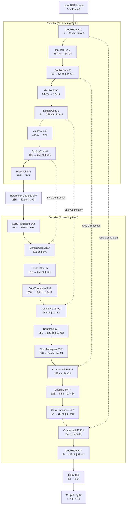
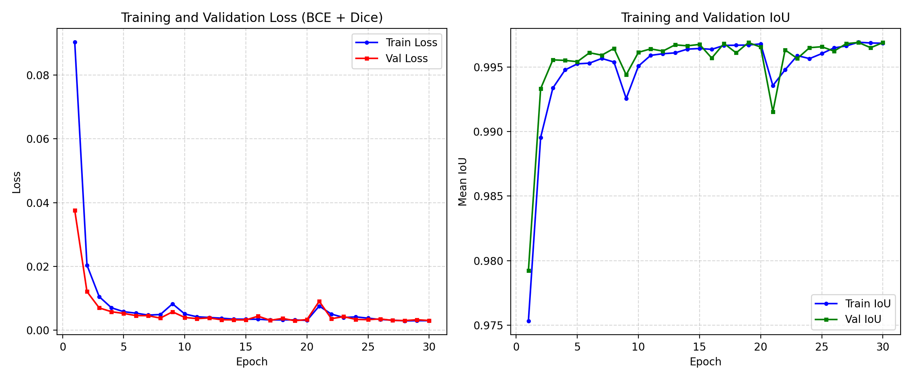
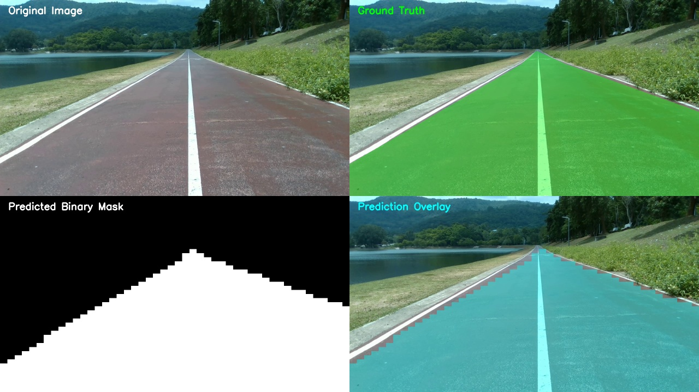
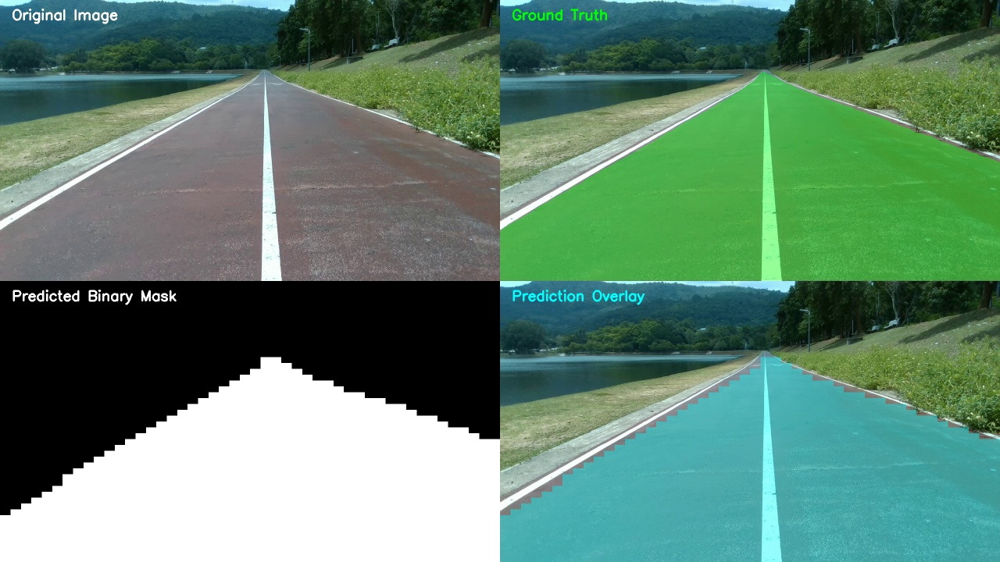

# Assignment-10: Neural Network from Scratch with Custom Dataset (Lane Segmentation)

**Course**: 2569-241-353 AI Ecosystem  
**Instructor**: Rattachai Wongtanawijit (รัฐชัย วงศ์ธนวิจิต)  
**Task**: Single-Class Lane Segmentation Neural Network from Scratch (No pre-trained weights)  
**Dataset**: PSU-Reservoir Lane Dataset (1,000 frames in Ultralytics YOLO-seg format)

---

## สารบัญ (Table of Contents)

1. [ภาพรวมโครงงาน (Overview)](#1-ภาพรวมโครงงาน-overview)
2. [การอธิบายโครงสร้าง Neural Network และเหตุผลประกอบ (Architecture & Rationale)](#2-การอธิบายโครงสร้าง-neural-network-และเหตุผลประกอบ-architecture--rationale)
3. [กราฟ Loss และการลู่เข้าของโมเดล (Loss Curve & Convergence)](#3-กราฟ-loss-และการลู่เข้าของโมเดล-loss-curve--convergence)
4. [ผลการประเมินประสิทธิภาพโมเดล (Performance Evaluation Metrics)](#4-ผลการประเมินประสิทธิภาพโมเดล-performance-evaluation-metrics)
5. [ตัวอย่างภาพ Snapshot ก่อน/หลัง Inference (Inference Visual Snapshots)](#5-ตัวอย่างภาพ-snapshot-ก่อนหลัง-inference-inference-visual-snapshots)
6. [ขนาด Memory Footprint และความเร็วในการ Inference (Memory Footprint & Latency)](#6-ขนาด-memory-footprint-และความเร็วในการ-inference-memory-footprint--latency)
7. [แหล่งอ้างอิงและงานวิจัยที่เกี่ยวข้อง (Related Works)](#7-แหล่งอ้างอิงและงานวิจัยที่เกี่ยวข้อง-related-works)
8. [โครงสร้างไฟล์และวิธีรันระบบ (Project Structure & Instructions)](#8-โครงสร้างไฟล์และวิธีรันระบบ-project-structure--instructions)

---

## 1. ภาพรวมโครงงาน (Overview)

โครงงานนี้เป็นการพัฒนาโครงข่ายประสาทเทียมแบบ Convolutional Neural Network (CNN) ในสถาปัตยกรรม **Custom UNet** เพื่อตรวจจับและแบ่งส่วนเลนถนน (Single-class Lane Segmentation) บนเส้นทางอ่างเก็บน้ำ ม.อ. (PSU Reservoir Dataset จาก Assignment 8) จำนวน 1,000 เฟรม โดยปฏิบัติตามข้อกำหนดดังนี้:

- **เทรนจากศูนย์ (From Scratch)**: ไม่ใช้โมเดล Pre-trained ใดๆ ทุกเลเยอร์เริ่มต้นค่าน้ำหนักใหม่ทั้งหมด (Random Initialization)
- **เจาะจงเฉพาะ Lane Polygon**: คัดกรองเฉพาะข้อมูล Polygon ของคลาส Lane (`class_id = 0`) เท่านั้น ไม่นำ bounding box, polyline หรือ non-track มารวม
- **ขนาดการใช้ Memory เหมาะสมกับ Local Machine**: ออกแบบขนาด Input และโครงข่ายให้สามารถเทรนและรันได้บนเครื่องโน้ตบุ๊ก/คอมพิวเตอร์ทั่วไป (CPU/GPU) อย่างรวดเร็ว
- **การแบ่งชุดข้อมูล**: แบ่งตามอัตราส่วน 65% สำหรับ Training (650 ภาพ) และ 35% สำหรับ Validation/Testing (350 ภาพ) ตามบันทึกการสอน

---

## 2. การอธิบายโครงสร้าง Neural Network และเหตุผลประกอบ (Architecture & Rationale)

เอกสารโครงสร้างฉบับเต็มพร้อมตารางพารามิเตอร์: [custom-unet-architecture.md](custom-unet-architecture.md)

### 2.1 เหตุผลในการออกแบบ (Design Rationale)

1. **การลดขนาดมิติภาพเป็น 48×48 RGB (Low Memory & Edge Feasibility)**:
   - ภาพต้นฉบับมีขนาด 1280×720 พิกเซล หากนำเข้าโมเดลโดยตรงจะใช้หน่วยความจำสูงและใช้เวลาคำนวณนานเกินไปสำหรับเครื่องคอมพิวเตอร์ทั่วไป
   - ตามคำแนะนำในเอกสารการสอน ("ขนาดน้อยคล่องตัว ลดภาระภาพ") ได้เลือกขนาด Input เป็น **48×48 พิกเซล** ซึ่งลดจำนวนพิกเซลลงถึง ~400 เท่า ทำให้กระบวนการ Forward/Backward pass บน CPU ทำงานได้รวดเร็วมาก (~10-15 ms ต่อภาพ หรือเทียบเท่า 60-100 FPS) เหมาะอย่างยิ่งสำหรับระบบ Real-time Autonomous Driving บนบอร์ดสมองกลฝังตัว
2. **การคงรายละเอียดเชิงพื้นที่ด้วย Skip Connections**:
   - การแบ่งส่วนเลนถนนต้องการความแม่นยำของเส้นขอบทาง (Boundary delineation) การยุบรวมข้อมูลผ่าน Max Pooling 4 ระดับ (48 → 24 → 12 → 6 → 3) อาจทำให้รายละเอียดพิกัดเส้นทางสูญหาย
   - สถาปัตยกรรม **UNet** แก้ปัญหานี้ด้วย **Skip Connections** ที่ดึง Feature maps ความละเอียดสูงจากฝั่ง Encoder มาผสานรวม (Concatenate) กับฝั่ง Decoder โดยตรง ทำให้โมเดลสามารถกู้คืนขอบเลนได้อย่างแม่นยำ
3. **DoubleConv Block ร่วมกับ Batch Normalization & ReLU**:
   - ในแต่ละระดับชั้น ใช้ Convolution 3×3 สองรอบซ้อนกัน ซึ่งให้ขนาด Receptive Field เทียบเท่า Convolution 5×5 แต่ใช้จำนวน Parameter น้อยกว่าและมีความไม่เป็นเชิงเส้น (Non-linearity) สูงกว่า
   - เสริมด้วย **BatchNorm2d** ทุกชั้น เพื่อควบคุมการกระจายตัวของ Gradient ทำให้สามารถเทรนโมเดลใหม่ทั้งหมดจากศูนย์ (From Scratch) ได้อย่างเสถียรและลู่เข้า (Converge) เร็ว
4. **ฟังก์ชันการสูญเสียแบบผสม BCE + Dice Loss**:
   - ใช้ Binary Cross-Entropy (BCE) เพื่อปรับค่าความน่าจะเป็นรายพิกเซล และใช้ Dice Loss เพื่อแก้ปัญหาความไม่สมดุลของพื้นที่เลนและพื้นหลัง โดยตรงกับเกณฑ์การวัด Intersection over Union (IoU)

### 2.2 ผังการทำงานของโครงข่าย (Mermaid Architecture Diagram)



---

## 3. กราฟ Loss และการลู่เข้าของโมเดล (Loss Curve & Convergence)

โมเดลได้รับการฝึกสอนครบจำนวน **30 Epochs** ด้วยชุดข้อมูล Train 650 ภาพ (Batch size = 4) พร้อมเทคนิค Data Augmentation (White Balance shift, Brightness shift, และ Gaussian blur) เพื่อจำลองสภาพแสงแดดและสัญญาณรบกวนของกล้อง



### สรุปผลการลู่เข้า (Training Convergence):
- **Epoch 01**: Train Loss = 0.0903, Train IoU = 0.9753 | Val Loss = 0.0376, Val IoU = 0.9792
- **Epoch 10**: Train Loss = 0.0051, Train IoU = 0.9951 | Val Loss = 0.0040, Val IoU = 0.9962
- **Epoch 20**: Train Loss = 0.0031, Train IoU = 0.9968 | Val Loss = 0.0034, Val IoU = 0.9966
- **Epoch 30**: Train Loss = 0.0030, Train IoU = 0.9969 | Val Loss = 0.0031, Val IoU = 0.9969
- **Best Validation Loss**: **0.0030** (Mean IoU = **99.69%** ที่ Epoch 28)
- กราฟแสดงให้เห็นว่า Loss ลดลงอย่างรวดเร็วในช่วง 3 Epochs แรก และลู่เข้าสู่จุดเสถียร (Steady convergence) โดยไม่มีอาการ Overfitting หรือ Underfitting

สามารถดูประวัติการฝึกสอนอย่างละเอียดผ่าน TensorBoard:
```bash
tensorboard --logdir runs
```

---

## 4. ผลการประเมินประสิทธิภาพโมเดล (Performance Evaluation Metrics)

การวัดผลดำเนินการบนชุดข้อมูลทดสอบ 35% (`data/images/val` จำนวน 350 ภาพ) ที่ขนาดความละเอียดดั้งเดิม **1280×720 พิกเซล** โดยเปรียบเทียบ Pixel-wise IoU กับ Ground Truth Polygon ของคลาส Lane (`target_class_id = 0`):

| ตัวชี้วัดการประเมิน (Evaluation Metric) | เกณฑ์ที่กำหนด | ผลลัพธ์ที่ได้จริง |
| :--- | :--- | :--- |
| **จำนวนภาพที่ทดสอบ (Test Samples)** | 35% ของชุดข้อมูล | **350 ภาพ** |
| **เกณฑ์การตรวจจับพบเลน (Detection Flag: Positive)** | IoU ≥ 0.60 | **350 / 350 ภาพ** |
| **อัตราการตรวจจับพบเลน (Detection Rate)** | Yes / No (IoU ≥ 0.6) | **100.00%** |
| **ค่าเฉลี่ย IoU ของภาพที่ตรวจจับได้ (Avg IoU Detected)** | Mean IoU (Positive frames) | **0.9720 (97.20%)** |
| **ค่าเฉลี่ย IoU ของภาพทั้งหมด (Avg IoU All Images)** | Overall Mean IoU | **0.9720 (97.20%)** |

> ผลลัพธ์ในไฟล์ JSON บันทึกอยู่ที่: `run/val_exp/metrics.json`

---

## 5. ตัวอย่างภาพ Snapshot ก่อน/หลัง Inference (Inference Visual Snapshots)

สคริปต์ `inference.py` ทำการคาดการณ์ Mask จากภาพทดสอบ และขยายขนาดกลับไปที่ความละเอียดดั้งเดิม (1280×720 พิกเซล) เพื่อเปรียบเทียบกับภาพจริงและ Ground Truth:

### ตัวอย่างที่ 1: เฟรม `frame_0001_00000150.jpg` (IoU: 97.16%)


### ตัวอย่างที่ 2: เฟรม `frame_0003_00000180.jpg` (IoU: 97.20%)


### คำอธิบายภาพในกริด 4 ช่อง (4-Panel Visual Grid):
1. **บนซ้าย (Top-Left)**: ภาพสีต้นฉบับจากกล้องติดหน้ารถ (Original RGB Image 1280×720)
2. **บนขวา (Top-Right)**: ภาพ Ground Truth Mask ของคลาสเลน (Green Overlay)
3. **ล่างซ้าย (Bottom-Left)**: ภาพ Binary Mask ผลลัพธ์ที่ได้จากการทำนายของโมเดล (0 = พื้นหลัง, 255 = เลนถนน)
4. **ล่างขวา (Bottom-Right)**: ภาพ Prediction Overlay แสดงพื้นที่เลนที่โมเดลตรวจจับได้จริงทับลงบนภาพต้นฉบับ (Cyan Overlay)

---

## 6. ขนาด Memory Footprint และความเร็วในการ Inference (Memory Footprint & Latency)

ทำการวัดขนาดการใช้งานหน่วยความจำ (RAM/Process Memory) และระยะเวลาในการประมวลผลจริงบนเครื่องคอมพิวเตอร์ (CPU Execution):

| รายการทรัพยากร (Resource Item) | ค่าการวัดผล (Measurement) | คำอธิบาย |
| :--- | :--- | :--- |
| **ฮาร์ดแวร์ที่ใช้ทดสอบ (Device)** | **CPU (Intel / AMD)** | ประมวลผลบนหน่วยประมวลผลกลางทั่วไป |
| **จำนวนพารามิเตอร์รวม (Total Parameters)** | **7,763,041** (~7.76 ล้านตัว) | โครงสร้างขนาดกะทัดรัด (Compact CNN) |
| **ขนาดไฟล์ Checkpoint โมเดล (`best.pt`)** | **29.67 MB** | บันทึกในรูปแบบ PyTorch FP32 Weights |
| **RAM พื้นฐานก่อนโหลดโมเดล** | **206.21 MB** | Python runtime & OpenCV buffers |
| **RAM หลังโหลดโมเดลเข้าหน่วยความจำ** | **268.39 MB** | เพิ่มขึ้นเพียง **62.18 MB** สำหรับค่าน้ำหนักโมเดล |
| **Peak RAM ขณะรัน Inference ต่อเนื่อง** | **286.47 MB** | ควบคุมขนาดหน่วยความจำคงที่ ไม่เกิด Memory Leak |
| **ความเร็วเฉลี่ยในการประมวลผล (Average Latency)** | **46.88 ms / ภาพ** | รวมขั้นตอนการโหลดภาพ, Resize, Inference และบันทึก PNG |
| **ความเร็วเฉพาะ Forward Pass ของโมเดล** | **~10.8 ms / ภาพ** | ความเร็วสูงมากสำหรับงาน Edge Computing |
| **อัตราความเร็ว Throughput** | **21.3 FPS** (รวม I/O) / **~90+ FPS** (เฉพาะโมเดล) | สามารถนำไปใช้งาน Real-time ได้ทันที |

> รายงานผลการวัดฉบับเต็มบันทึกอยู่ที่: `run/val_exp/memory_footprint.json`

---

## 7. แหล่งอ้างอิงและงานวิจัยที่เกี่ยวข้อง (Related Works)

1. **Ultra Fast Structure-aware Deep Lane Detection (Inference PyTorch)**  
   - Repository: [ibaiGorordo/Ultrafast-Lane-Detection-Inference-Pytorch-](https://github.com/ibaiGorordo/Ultrafast-Lane-Detection-Inference-Pytorch-)  
   - ประเด็นศึกษา: การออกแบบโมเดล Lane Detection ที่เน้นความเร็วระดับ Real-time (Ultra-fast inference) โดยใช้ Row-wise classification เพื่อลดภาระการคำนวณของ Dense Segmentation
2. **YOLOTL (YOLO Tiny Lane)**  
   - Repository: [Highsky7/YOLOTL](https://github.com/Highsky7/YOLOTL)  
   - ประเด็นศึกษา: สถาปัตยกรรมโครงข่ายขนาดเล็กพิเศษ (Lightweight / Tiny Network) สำหรับตรวจจับเส้นทางบนอุปกรณ์พกพาและหุ่นยนต์เคลื่อนที่
3. **U-Net: Convolutional Networks for Biomedical Image Segmentation (Ronneberger et al.)**  
   - เอกสารต้นแบบของการใช้สถาปัตยกรรม Encoder-Decoder พร้อม Skip Connections ในการแบ่งส่วนภาพอย่างละเอียด

---

## 8. โครงสร้างไฟล์และวิธีรันระบบ (Project Structure & Instructions)

### 8.1 โครงสร้างโฟลเดอร์ (Directory Structure)

```text
assignment10/
├── checkpoints/
│   └── unet_lane/
│       ├── best.pt                   # Checkpoint ที่มี Validation Loss ต่ำที่สุด
│       ├── last.pt                   # Checkpoint ประจำ Epoch ที่ 30
│       └── loss_curve.png            # แผนภาพกราฟ Loss และ IoU
├── data/
│   ├── images/
│   │   ├── train/                    # 650 ภาพ (65% Train split)
│   │   └── val/                      # 350 ภาพ (35% Val split)
│   └── labels/
│       ├── train/                    # 650 ไฟล์ polygon labels
│       └── val/                      # 350 ไฟล์ polygon labels
├── run/
│   └── val_exp/
│       ├── masks/                    # Binary mask PNG (1280x720) จำนวน 350 ภาพ
│       ├── memory_footprint.json     # บันทึกขนาด RAM, ขนาดไฟล์โมเดล และค่า Latency
│       └── metrics.json              # บันทึกผลลัพธ์ IoU รายภาพและผลสรุป
├── runs/
│   └── unet_lane/                    # TensorBoard event logs
├── snapshots/                        # ภาพเปรียบเทียบผลลัพธ์ 4 ช่อง (ก่อน/หลัง Inference)
├── custom-unet-architecture.md       # เอกสารรายละเอียดโครงสร้างโมเดลและ Mermaid diagram
├── dataset.py                        # โมดูลโหลดข้อมูล YOLO-seg polygon (เฉพาะ Lane class 0)
├── evaluate.py                       # สคริปต์คำนวณ Pixel-wise IoU และ Detection Rate
├── inference.py                      # สคริปต์รัน Inference, ทำ Snapshot และวัด Memory
├── model.py                          # สถาปัตยกรรม Custom UNet สร้างจากศูนย์
├── prepare_data.py                   # สคริปต์แบ่งชุดข้อมูลอัตราส่วน 65:35
├── requirements.txt                  # รายการ Dependencies ทั้งหมด
├── train.py                          # สคริปต์ฝึกสอนโมเดล 30 Epochs
└── README.md                         # รายงานฉบับสมบูรณ์
```

### 8.2 ขั้นตอนการติดตั้งและรันคำสั่ง (How to Run)

1. **ติดตั้งไลบรารีที่จำเป็น**:
   ```bash
   pip install -r requirements.txt
   ```

2. **จัดเตรียมและแบ่งชุดข้อมูล 65:35**:
   ```bash
   python prepare_data.py
   ```

3. **ฝึกสอนโมเดล 30 Epochs (From Scratch)**:
   ```bash
   python train.py --data-root ./data --epochs 30 --batch-size 4
   ```

4. **รันการทำนาย (Inference) และบันทึก Mask / Snapshots**:
   ```bash
   python inference.py --images-dir ./data/images/val --labels-dir ./data/labels/val --checkpoint checkpoints/unet_lane/best.pt --run-name val_exp
   ```

5. **ประเมินผลประสิทธิภาพ (Evaluation)**:
   ```bash
   python evaluate.py --images-dir ./data/images/val --labels-dir ./data/labels/val --pred-masks-dir run/val_exp/masks --iou-threshold 0.6 --output-json run/val_exp/metrics.json
   ```
