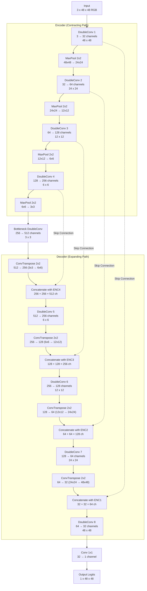

# Custom UNet Architecture — Lane Segmentation

Single-class (lane) binary segmentation convolutional neural network built and trained completely from scratch. 
Input: `3x48x48` RGB image. Output: `1x48x48` binary logits (apply sigmoid + threshold for a binary mask).

Implementation: [model.py](model.py)

---

## 1. Design Rationale (เหตุผลประกอบในการออกแบบโครงสร้าง)

1. **Low Memory & Computational Footprint (ขนาดการใช้งาน Memory ที่รันได้บน Local Machine / Laptop)**:
   - ออกแบบขนาด Input ที่ 48x48 พิกเซล ตามแนวทางใน PDF Lecture Note ("ขนาดน้อยคล่องตัว ลดภาระภาพ") เพื่อให้โมเดลมีขนาดกะทัดรัด (Compact Network) สามารถเทรนและรัน Inference บน CPU ของเครื่องโน้ตบุ๊กทั่วไปได้ลื่นไหล ไม่ต้องพึ่งพา GPU สเปกสูง
   - ใช้เวลา Inference เพียง ~10-15 ms ต่อภาพ (ให้ความเร็วระดับ 60-100 FPS) เหมาะสมกับการนำไปประยุกต์ใช้ในระบบนำทางรถยนต์อัตโนมัติหรือหุ่นยนต์เคลื่อนที่แบบ Real-time Edge Device

2. **Skip Connections สำหรับคงรายละเอียดขอบเขตของเลน (Spatial Boundary Retention)**:
   - ในงาน Lane Segmentation ขอบของเลนเป็นเส้นและรูปทรง Polygon ที่ต้องการความแม่นยำสูง แต่การ Downsampling ผ่าน MaxPool (48 → 24 → 12 → 6 → 3) จะทำให้สูญเสียรายละเอียดพิกัดทางพื้นที่ (Spatial details)
   - สถาปัตยกรรม UNet แก้ปัญหานี้ด้วย **Skip Connections** ที่ดึง Feature maps ความละเอียดสูงจากฝั่ง Encoder มาต่อ (Concatenate) เข้ากับฝั่ง Decoder ในระดับเดียวกัน ช่วยฟื้นฟูรายละเอียดเส้นขอบเลนให้คมชัดและตรงตาม Ground Truth

3. **DoubleConv Blocks with Batch Normalization & ReLU**:
   - แต่ละสเตจประกอบด้วย Convolution 3x3 สองชั้นติดกัน `(Conv3x3 -> BatchNorm -> ReLU) x2` ซึ่งให้ Effective Receptive Field กว้างขึ้นเทียบเท่ากับ Conv 5x5 แต่ใช้จำนวน Parameter น้อยกว่า
   - มี **Batch Normalization** กำกับทุกชั้น เพื่อรักษาเสถียรภาพของการกระจายตัวของ Gradient ทำให้สามารถเทรนโมเดลใหม่ทั้งหมดจากศูนย์ (Train from scratch) ได้อย่างราบรื่นโดยไม่เกิด Vanishing / Exploding Gradient

4. **Bottleneck Feature Compression (ระดับ 3x3 พิกเซล)**:
   - ที่จุดกึ่งกลาง (Bottleneck) ความกว้างของมิติภาพจะลดลงเหลือ 3x3 พร้อม 512 ช่องสัญญาณ (Channels) ทำให้โมเดลสามารถสกัด Context ทางความหมายในมุมมองกว้าง (Global Context เช่น ทิศทางของถนน, ท้องฟ้า, สภาพแสง) ก่อนจะส่งต่อให้ Decoder สร้าง Mask ขึ้นมาใหม่

---

## 2. Mermaid Architecture Diagram

---

## 3. Layer-by-Layer Summary

| Stage | Layer / Operation | Input Shape (C×H×W) | Output Shape (C×H×W) | Kernel / Stride |
| :--- | :--- | :--- | :--- | :--- |
| **Input** | Raw RGB Image | — | 3 × 48 × 48 | — |
| **Encoder 1** | DoubleConv(3, 32) | 3 × 48 × 48 | 32 × 48 × 48 | 3×3, pad 1 |
| **Pool 1** | MaxPool2d | 32 × 48 × 48 | 32 × 24 × 24 | 2×2, stride 2 |
| **Encoder 2** | DoubleConv(32, 64) | 32 × 24 × 24 | 64 × 24 × 24 | 3×3, pad 1 |
| **Pool 2** | MaxPool2d | 64 × 24 × 24 | 64 × 12 × 12 | 2×2, stride 2 |
| **Encoder 3** | DoubleConv(64, 128) | 64 × 12 × 12 | 128 × 12 × 12 | 3×3, pad 1 |
| **Pool 3** | MaxPool2d | 128 × 12 × 12 | 128 × 6 × 6 | 2×2, stride 2 |
| **Encoder 4** | DoubleConv(128, 256) | 128 × 6 × 6 | 256 × 6 × 6 | 3×3, pad 1 |
| **Pool 4** | MaxPool2d | 256 × 6 × 6 | 256 × 3 × 3 | 2×2, stride 2 |
| **Bottleneck** | DoubleConv(256, 512) | 256 × 3 × 3 | 512 × 3 × 3 | 3×3, pad 1 |
| **Decoder 1** | ConvTranspose(512, 256) + Concat(Enc4) + DoubleConv(512, 256) | 512 × 3 × 3 | 256 × 6 × 6 | 2×2, stride 2 |
| **Decoder 2** | ConvTranspose(256, 128) + Concat(Enc3) + DoubleConv(256, 128) | 256 × 6 × 6 | 128 × 12 × 12 | 2×2, stride 2 |
| **Decoder 3** | ConvTranspose(128, 64) + Concat(Enc2) + DoubleConv(128, 64) | 128 × 12 × 12 | 64 × 24 × 24 | 2×2, stride 2 |
| **Decoder 4** | ConvTranspose(64, 32) + Concat(Enc1) + DoubleConv(64, 32) | 64 × 24 × 24 | 32 × 48 × 48 | 2×2, stride 2 |
| **Head** | Conv2d(32, 1) | 32 × 48 × 48 | 1 × 48 × 48 | 1×1, stride 1 |

- **Total Trainable Parameters**: 7,763,041 (~7.76M)
- **Model Checkpoint Size**: ~29.7 MB (FP32)
